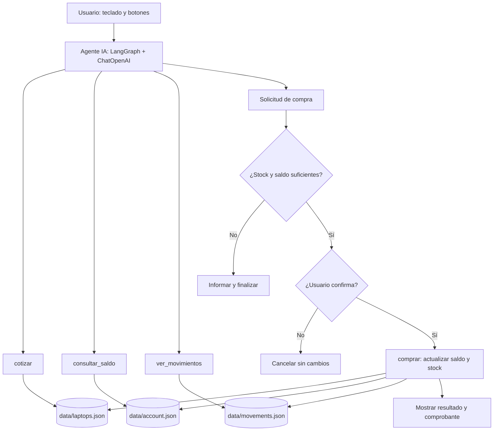

Agente de IA | Tienda de Laptops
Proyecto académico de un agente inteligente que permite cotizar y realizar compras simuladas de laptops, utilizando Python, LangGraph, ChatOpenAI y archivos JSON como almacenamiento local.
Objetivo
Desarrollar un agente que interprete solicitudes escritas por el usuario, consulte un catálogo de laptops, verifique el saldo disponible y permita confirmar una compra simulada, dejando constancia en un historial de movimientos.
Funcionalidades
Consultar modelos, precios y existencias.
Conversar con el agente mediante teclado y botón Enviar.
Seleccionar una laptop y especificar la cantidad con los controles + y −.
Calcular el importe total de la compra.
Consultar saldo y comprobar si alcanza para la compra.
Confirmar o cancelar una compra simulada.
Registrar movimientos y actualizar saldo e inventario en archivos JSON.
Tecnologías
Python: lógica e interfaz de escritorio.
LangGraph: organización del flujo del agente.
ChatOpenAI: interpretación de mensajes en lenguaje natural mediante la API de OpenAI.
JSON: catálogo, cuenta e historial simulados.
Arquitectura del agente

Estructura del proyecto
```text
agente-ia-tienda-laptops/
├── main.py                       # Lógica del agente
├── interfaz_premium_teclado.py   # Interfaz gráfica
├── requirements.txt              # Dependencias
├── README.md                     # Documentación
└── data/
    ├── laptops.json              # Productos y stock
    ├── account.json              # Saldo simulado
    └── movements.json            # Historial de compras
```
El archivo `.env` se crea solo en la computadora de quien ejecute el proyecto y no debe publicarse en GitHub.
Instalación en Windows
Instala Python y verifica que funcione en CMD:
```bash
   py --version
   ```
Descarga este repositorio mediante Code → Download ZIP y extrae su contenido.
Abre CMD en la carpeta del proyecto e instala las dependencias:
```bash
   py -m pip install -r requirements.txt
   ```
Crea un archivo llamado `.env` en la raíz del proyecto con esta línea, reemplazando el texto de ejemplo por tu propia clave API:
```dotenv
   OPENAI_API_KEY=TU_CLAVE_API_AQUI
   ```
Inicia la interfaz:
```bash
   py interfaz_premium_teclado.py
   ```
> La conexión con ChatOpenAI requiere acceso a la API de OpenAI y puede generar cargos según su uso. Una suscripción a ChatGPT no equivale a crédito de API.
Ejemplo de uso
Escribe: «Hola, quiero cotizar una laptop Lenovo».
El agente consulta el catálogo y responde con precio y disponibilidad.
Selecciona el modelo y la cantidad deseada.
Presiona COMPRAR LAPTOP.
Revisa los datos y confirma o cancela la operación.
Si la compra es válida, el sistema actualiza los archivos JSON y registra el movimiento.
Herramientas del agente
Herramienta	Función
`cotizar(simbolo)`	Consulta el precio y disponibilidad del modelo.
`consultar_saldo()`	Consulta el saldo simulado.
`comprar(simbolo, cantidad)`	Ejecuta la compra simulada tras las verificaciones y la confirmación.
`ver_movimientos()`	Consulta el historial de operaciones.
Seguridad y alcance
Este es un proyecto académico de simulación: no procesa pagos reales ni vende productos reales. No publiques el archivo `.env`, claves API ni datos privados. Para mantener tu clave fuera del repositorio, agrega un `.gitignore` con `.env`, `.venv/` y `__pycache__/`.
Autoría
Proyecto desarrollado por ANGEL EDUARDO SALDARRIAGA ESPINOZA EN CONJUNTO CON JENIFER VILLALVA Y JOSSELIN VERA como actividad académica en La carrera de Computación de cuarto semestre de la ESPAM MFL.
Repositorio: https://github.com/angelsaldarriaga0220-ux/agente-ia-tienda-laptops
